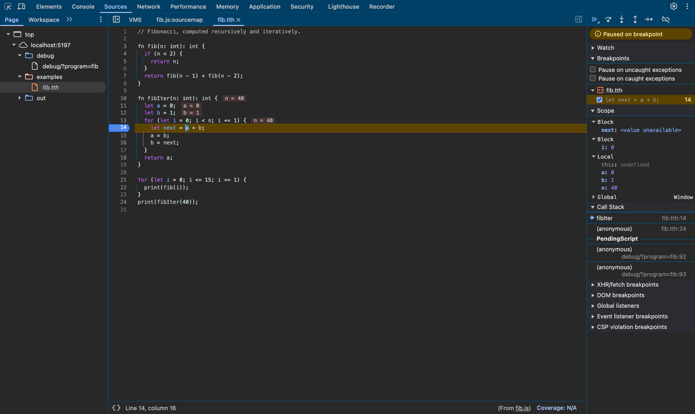
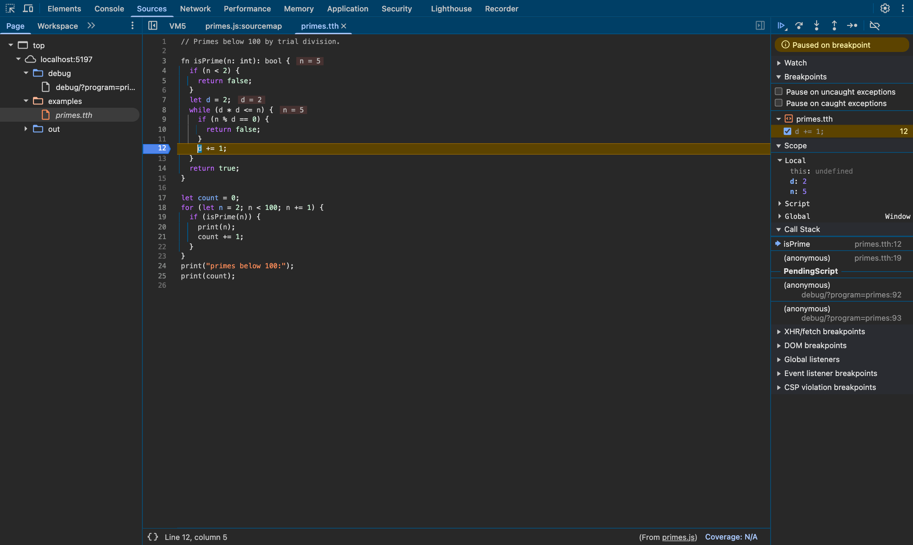
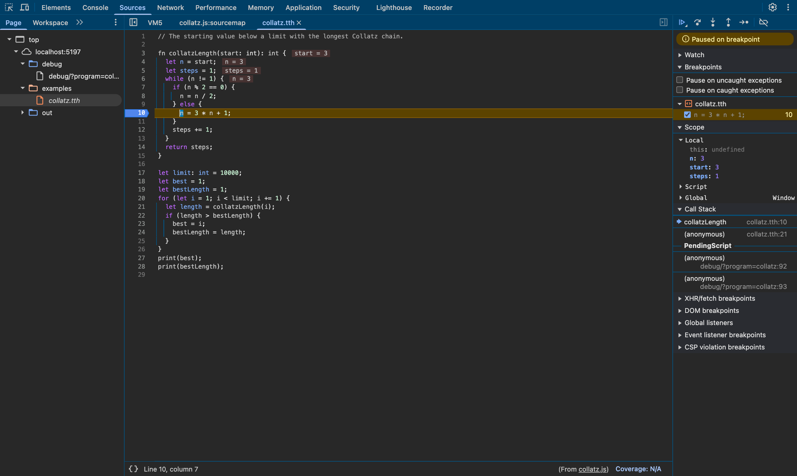
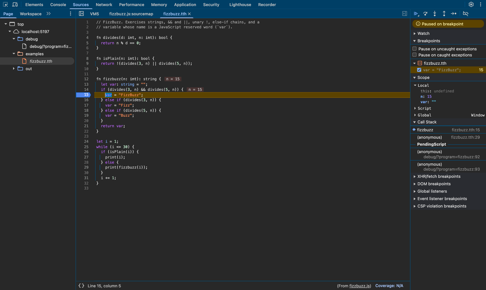
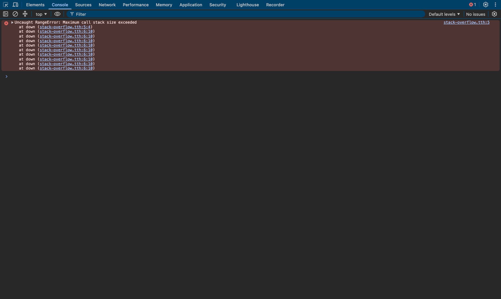

# Browser verification (milestone 7)

Generated by `npm run verify:browser` on 2026-10-28, with Chrome/156.0.8078.48 and Node 25.4.0.
Do not edit by hand; run the script again instead.

## Method

Each compiled benchmark runs in `debug/index.html`, an ordinary web page that
loads `out/<name>.js`. Chrome reads the `sourceMappingURL` comment, loads
`out/<name>.js.map` and lists the original `.tth` file in DevTools.

For every statement below, the script drives Chrome's own DevTools user
interface as a person would: quick-open the `.tth` file, go to the line, and
toggle a breakpoint. DevTools uses the source map to place the breakpoint in
the generated JavaScript. The page is then reloaded and the script records
where Chrome stops. That position is translated back with Node's built-in
`SourceMap` class (independent of Tether's encoder) and must be on the same
`.tth` line.

## AC-2: breakpoints on original source lines

**20 of 20 breakpoints** (in 4 programs) halted at the statement
on which they were set. AC-2 needs at least ten.

| .tth line | Statement | Chrome paused in | at | maps back to | |
|-----------|-----------|------------------|----|--------------|---|
| `fib.tth:4` | `if (n < 2) {` | fib | `out/fib.js:3:3` | `fib.tth:4:3` | pass |
| `fib.tth:5` | `return n;` | fib | `out/fib.js:4:5` | `fib.tth:5:5` | pass |
| `fib.tth:7` | `return fib(n - 1) + fib(n - 2);` | fib | `out/fib.js:6:3` | `fib.tth:7:3` | pass |
| `fib.tth:11` | `let a = 0;` | fibIter | `out/fib.js:9:11` | `fib.tth:11:11` | pass |
| `fib.tth:14` | `let next = a + b;` | fibIter | `out/fib.js:14:18` | `fib.tth:14:16` | pass |
| `fib.tth:15` | `a = b;` | fibIter | `out/fib.js:15:7` | `fib.tth:15:5` | pass |
| `fib.tth:18` | `return a;` | fibIter | `out/fib.js:20:3` | `fib.tth:18:3` | pass |
| `fib.tth:22` | `print(fib(i));` | (top level) | `out/fib.js:25:5` | `fib.tth:22:3` | pass |
| `fib.tth:24` | `print(fibIter(40));` | (top level) | `out/fib.js:29:1` | `fib.tth:24:1` | pass |
| `primes.tth:7` | `let d = 2;` | isPrime | `out/primes.js:6:11` | `primes.tth:7:11` | pass |
| `primes.tth:12` | `d += 1;` | isPrime | `out/primes.js:11:5` | `primes.tth:12:5` | pass |
| `primes.tth:20` | `print(n);` | (top level) | `out/primes.js:20:7` | `primes.tth:20:5` | pass |
| `primes.tth:25` | `print(count);` | (top level) | `out/primes.js:27:1` | `primes.tth:25:1` | pass |
| `collatz.tth:8` | `n = n / 2;` | collatzLength | `out/collatz.js:7:7` | `collatz.tth:8:7` | pass |
| `collatz.tth:10` | `n = 3 * n + 1;` | collatzLength | `out/collatz.js:9:7` | `collatz.tth:10:7` | pass |
| `collatz.tth:21` | `let length = collatzLength(i);` | (top level) | `out/collatz.js:21:18` | `collatz.tth:21:16` | pass |
| `fizzbuzz.tth:5` | `return n % d == 0;` | divides | `out/fizzbuzz.js:3:3` | `fizzbuzz.tth:5:3` | pass |
| `fizzbuzz.tth:15` | `var = "FizzBuzz";` | fizzbuzz | `out/fizzbuzz.js:11:5` | `fizzbuzz.tth:15:5` | pass |
| `fizzbuzz.tth:17` | `var = "Fizz";` | fizzbuzz | `out/fizzbuzz.js:13:5` | `fizzbuzz.tth:17:5` | pass |
| `fizzbuzz.tth:29` | `print(fizzbuzz(i));` | (top level) | `out/fizzbuzz.js:24:5` | `fizzbuzz.tth:29:5` | pass |

"at" is the generated position (1-based line:column) where V8 stopped. V8 may
move a breakpoint to the nearest place it can stop, for example from the start
of `let next = a + b;` to the start of `a + b`; the mapped position is still
inside the same statement.

### fib.tth line 14: `let next = a + b;`



### primes.tth line 12: `d += 1;`



### collatz.tth line 10: `n = 3 * n + 1;`



### fizzbuzz.tth line 15: `var = "FizzBuzz";`



## AC-5: a runtime exception's stack trace names the original file and line

`test/fixtures/stack-overflow.tth` recurses until the stack overflows. Chrome
reports the uncaught exception; its stack frames, translated through the map:

| Function | Generated position | Original position | |
|----------|--------------------|-------------------|---|
| `down` | `out/stack-overflow.js:2:14` | `test/fixtures/stack-overflow.tth:5:4` | pass |
| `down` | `out/stack-overflow.js:3:10` | `test/fixtures/stack-overflow.tth:6:10` | pass |
| `down` | `out/stack-overflow.js:3:10` | `test/fixtures/stack-overflow.tth:6:10` | pass |

Exception: `RangeError: Maximum call stack size exceeded`. The DevTools console shows the same frames,
linked to `stack-overflow.tth`:



Node shows the same thing on the command line:
`node --enable-source-maps out/stack-overflow.js` reports
`at down (…/test/fixtures/stack-overflow.tth:6:10)`.

## Doing it by hand

```sh
npm run build:examples
npm run playground          # serves the project on http://localhost:5173
```

1. Open `http://localhost:5173/debug/?program=fib` in Chrome.
2. Open DevTools (⌥⌘I or F12), choose **Sources**, and open
   `localhost:5173 → examples → fib.tth`.
3. Click line number 14 to set a breakpoint, then reload the page. Chrome stops
   on `let next = a + b;`, with `fibIter` in the call stack and `a`, `b` and
   `n` under Scope.
4. Open `http://localhost:5173/debug/?program=stack-overflow` with the
   **Console** open. The `RangeError` stack trace links to
   `stack-overflow.tth:6`.
